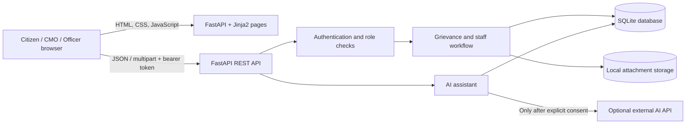

# System Architecture

## Request and trust boundaries

1. The browser requests public or role-specific server-rendered pages.
2. JavaScript calls `/api/...` endpoints. Authenticated calls carry an opaque bearer token; only its hash is stored.
3. API routes enforce citizen, admin, or officer role and ownership/assignment checks before accessing records.
4. SQLite stores accounts, grievances, status history, assignments, action reports, feedback, enquiries, and AI suggestions.
5. Uploaded attachments are stored in the local `uploads/` directory and retrieved through authorized API routes.
6. If an AI provider is configured, complaint subject and description leave the application only after the citizen's explicit consent. AI output is advisory.

## Deployment notes

The included Dockerfile is a starting point for a container host. Mount persistent storage at `/data` and configure `DATABASE_PATH=/data/grievances.db`; attachment storage also needs persistence. Set credentials in the hosting provider's secret manager, not in source control. Configure HTTPS, backups, rate limiting, operational monitoring, and a privacy review before any real-world use.
