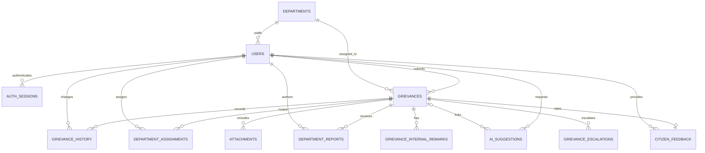

# Database Design

The application initializes its SQLite schema on startup. Primary/foreign keys and selected `CHECK` constraints enforce relational integrity and supported values.

## Main entities

| Entity | Purpose |
|---|---|
| `users`, `auth_sessions` | Citizen/staff identities and hashed bearer-token sessions |
| `departments` | Seeded sample directory spanning health, education, food/civil supplies, social welfare, NORKA, infrastructure, transport, power/water, agriculture, industry/IT, and environment |
| `grievances` | Citizen complaint, current status, priority, and assignment |
| `grievance_history` | Append-only status transitions with actor, timestamp, and remark |
| `department_assignments` | Department/officer routing history |
| `department_reports` | Officer action report and CMO review decision |
| `attachments` | File metadata; file bytes live under `uploads/` |
| `ai_suggestions` | Advisory output, source/model, user, hashes, and optional grievance link |
| `citizen_feedback` | One 1–5 rating/comment per resolved grievance |
| `contact_enquiries` | Public questions and suggestions about the demonstration |
| `grievance_internal_remarks`, `grievance_escalations` | CMO-only notes and escalation records |

`citizen_feedback.grievance_id` is unique. Feedback is accepted only from the owning citizen and only once the case is resolved.
